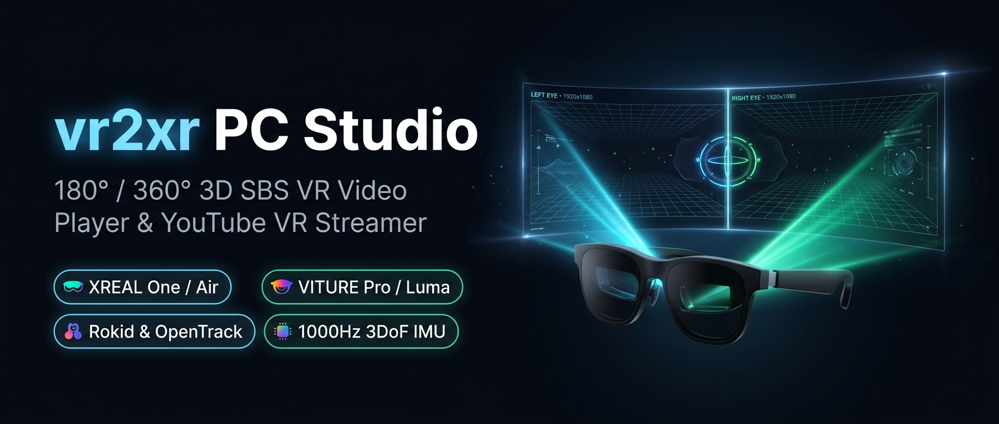
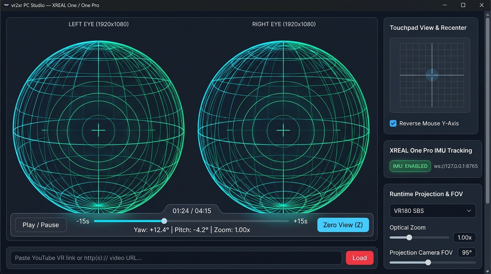

<div align="center">



# vr2xr PC Studio for XREAL & VITURE AR Glasses

**180° / 360° Stereoscopic Side-by-Side (SBS) VR Video Player, 3DoF IMU Head-Tracking Bridge & YouTube VR Streamer for Windows / Linux / macOS**

[](https://github.com/f1nal-b0ss/vr2xr-pc/releases/latest)
[](https://github.com/f1nal-b0ss/vr2xr-pc)
[](https://github.com/f1nal-b0ss/vr2xr-pc)
[](https://github.com/f1nal-b0ss/vr2xr-pc)
[](./LICENSE)

*Inspired by [Skarian/vr2xr](https://github.com/skarian/vr2xr), [SamiMitwalli/One-Pro-IMU-Retriever-Demo](https://github.com/SamiMitwalli/One-Pro-IMU-Retriever-Demo), and [bfvogel/viture-webxr-extension](https://github.com/bfvogel/viture-webxr-extension).*

</div>

## 📥 Instant Download (No Python Required)

👉 **[Download `vr2xr_PC_Studio.exe` from the Latest GitHub Release](https://github.com/f1nal-b0ss/vr2xr-pc/releases/latest)**

Double-click `vr2xr_PC_Studio.exe` on Windows 10/11 to automatically start the 3DoF IMU head-tracking bridge, local YouTube VR180 stream proxy, and native-style VR player window in one click!

## 🕶️ Supported AR Glasses & Head Tracking Matrix

| Glasses Brand & Model | `3840×1080` 3D SBS & YouTube VR | 3DoF Head Tracking Method in `vr2xr PC Studio` |
| :--- | :--- | :--- |
| **XREAL One & XREAL One Pro** | ✅ Native (`3D Mode` in X1 OSD) | ✅ **Plug-and-Play USB-C TCP (`169.254.2.1:52998`)** — Auto-connects via `vr2xr_PC_Studio.exe` / `xreal_imu_bridge.py` |
| **VITURE One, Lite, Pro XR & Luma** | ✅ Native (Hold **Mode** button 2s for 3D SBS) | ✅ **Native USB WebHID (`0x35CA`) & Python `hidapi`** — Sends `0xFF 0xFE` (`CmdIMU=0x0015` + CRC-16) and decodes big-endian Euler poses at offset 18 |
| **XREAL Air / Air 2 / Air 2 Pro / Ultra** | ✅ Native (Hold **Brightness +** 2s for 3D SBS) | ✅ **USB WebHID (`0x3318`), Python `hidapi` & OpenTrack UDP** |
| **Rokid Air / Max / Max 2 & RayNeo** | ✅ Native (`3840×1080` 3D SBS mode) | ✅ **USB WebHID (`0x04D2` / `0x1BBB`), OpenTrack UDP (`--opentrack-udp 4242`) & Free-Look Mouse (`M`)** |

## 🖥️ Live App Screenshot

<div align="center">



</div>

## ✨ Key Features

* **🌐 100% True Spherical 3D WebGL Projections**:
  * **VR180 Equirectangular Hemisphere**: Standard 180° stereoscopic dome mapping Left Eye (`u ∈ [0, 0.5]`) and Right Eye (`u ∈ [0.5, 1.0]`).
  * **VR180 Equidistant Fisheye**: True spherical fisheye UV projection for dual-fisheye VR180 cameras.
  * **VR360 Full Sphere**: Complete 360° stereoscopic sphere.
  * **Cinema 3D Dome**: Curved 110° × 70° spherical theater screen.
* **🎯 Multi-Brand 3DoF Head Tracking (XREAL + VITURE + Rokid + OpenTrack)**:
  * **XREAL One / One Pro**: Connects directly to the USB-C NCM/RNDIS telemetry stream (`169.254.2.1:52998` & `169.254.1.1:52998`) with **Smart Firmware Auto-Alignment** using Earth's gravity vector (`~9.81 m/s²`).
  * **VITURE One / Lite / Pro XR (`0x35CA`)**: Native support in both browser **USB WebHID** and the Python bridge (`hidapi`), automatically sending the `0xFF 0xFE` CRC-16 `CmdIMU` (`0x0015`) activation packet and decoding big-endian float32 Euler angles at byte offset 18.
  * **Additional Input Fallbacks**: Includes **XREAL Air (`0x3318`)**, **Rokid (`0x04D2`)**, **OpenTrack UDP relay (`--opentrack-udp 4242`)**, virtual gamepad polling, and **Free-Look Mouse Pointer Lock (`M` key)**.
* **▶️ Built-In YouTube VR180 / 3D Streamer (`http://127.0.0.1:8766`)**:
  * Paste any YouTube VR180 or 3D SBS video link directly into the player and click **Load**.
  * Uses `yt-dlp` to buffer high-resolution H.264/VP9 video (`bv*/b`) and companion audio (`ba*/b`) into `yt_cache/`—working seamlessly **even without `ffmpeg` installed**—and serves them locally with `Access-Control-Allow-Origin: *` and HTTP Byte-Range support.
* **⏱️ Auto-Hiding Fullscreen Progress Bar (3-Second Fade)**:
  * Interactive timeline scrubber, Play/Pause, `-15s`/`+15s` seek buttons, and live pose telemetry overlay in both **Glasses Fullscreen** and the **Pop-Out Glasses Display** window.
  * Automatically appears on mouse movement, click, scroll, or keypress and fades away after **3 seconds** of inactivity (hiding the mouse cursor in fullscreen).
* **🔍 Optical Zoom & Reversed Y-Axis Mouse Look**:
  * Smooth `0.50×` to `3.00×` optical camera zoom via mouse wheel, `+`/`-`/`0` hotkeys, or slider.
  * Reversed vertical mouse drag axis (enabled by default, with a UI toggle in the Touchpad deck) plus continuous edge auto-pan.
* **📦 One-Click Standalone Windows `.EXE` Compiler**:
  * Double-click `Build_Standalone_EXE.bat` to bundle `vr2xr_pc_player.html`, `xreal_imu_bridge.py`, `websockets`, `yt-dlp`, and `hidapi` into a single standalone **`vr2xr_PC_Studio.exe`** executable via PyInstaller.

## 🚀 Quick Start

### For XREAL One / One Pro Users
1. Plug in your **XREAL One Pro / One** via USB-C, double-click the red **X** button on the glasses, and enable **3D Mode** + **Follow Mode** (Stabilization Off).
2. Double-click **`vr2xr_PC_Studio.exe`** (or **`Launch_vr2xr_PC.bat`**) — 1000Hz head tracking and YouTube VR streaming connect automatically!

### For VITURE One / Lite / Pro XR / Luma Users
1. Plug in your **VITURE** glasses via USB-C and hold the **Mode (short)** button for ~2 seconds to switch the glasses to **`3840×1080` 3D SBS mode**.
2. Double-click **`vr2xr_PC_Studio.exe`** (or **`Launch_vr2xr_PC.bat`**).
3. Head tracking connects automatically via the bridge, or you can click the **`USB WebHID`** button right inside the player window to pair your VITURE (`0x35CA`) glasses directly in Chrome/Edge!

## ⌨️ Keyboard & Mouse Controls

| Input / Hotkey | Action |
| :--- | :--- |
| **`Z`** | **Zero View** — Lock current head orientation as neutral forward center |
| **`R`** | **Recalibrate IMU** — Run 250-sample stationary gyroscope bias calibration |
| **`F`** | **Toggle Glasses Fullscreen** (or use **Pop-Out Glasses Display**) |
| **`M`** | **Toggle Free-Look Mouse Mode** (Pointer Lock look-around without holding click) |
| **`Space`** | **Play / Pause** active VR video or procedural test dome |
| **`Mouse Wheel` / `+` / `-`** | **Optical Zoom In / Out** (`0.50×` – `3.00×`) |
| **`0`** | **Reset Optical Zoom** to `1.00×` |
| **`←` / `→`** | **Seek Backward / Forward** `±15 seconds` |
| **`↑` / `↓`** | **Adjust Projection FOV** `±2°` (`50°` – `135°`) |

## 🛠️ Command-Line Options (`xreal_imu_bridge.py`)

```bash
python xreal_imu_bridge.py --help
```

* `--host 169.254.2.1` — XREAL One Pro USB-C NCM IPv4 address (automatically falls back to `169.254.1.1`)
* `--port 52998` — XREAL One Pro TCP IMU port
* `--ws-port 8765` — Local WebSocket telemetry port
* `--http-port 8766` — Local HTTP App & YouTube VR proxy port
* `--opentrack-udp 4242` — Relay 6-double UDP pose packets from OpenTrack
* `--simulate` — Run synthetic 3DoF head motion without glasses connected
* `--no-browser` — Do not auto-launch the browser app window on startup

## 📄 License

Released under the [MIT License](./LICENSE).